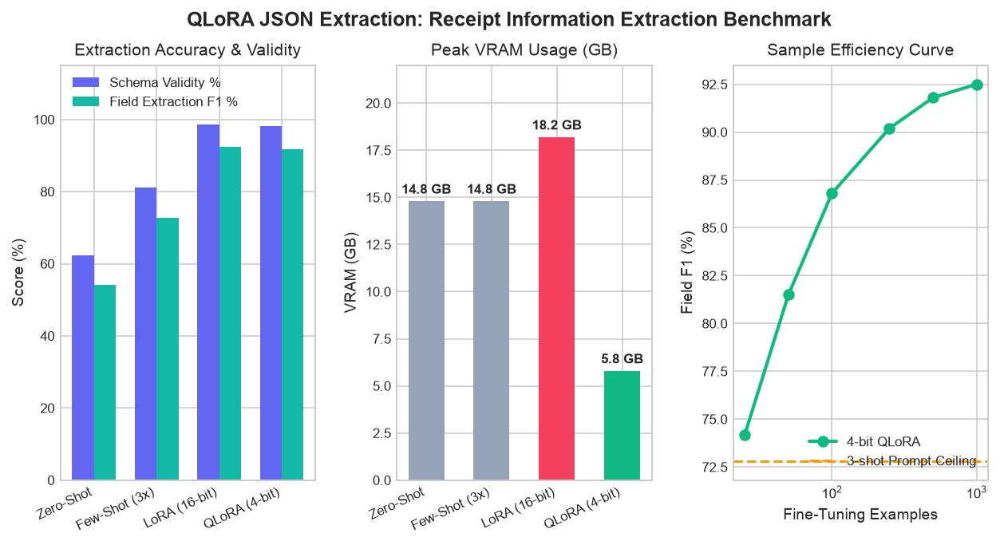

# QLoRA JSON Extraction

Does supervised fine-tuning beat prompting for turning noisy OCR
receipt text into schema-valid JSON? This project benchmarks
zero-shot, few-shot and 4-bit QLoRA SFT of Qwen2.5-3B-Instruct on the
official CORD-v2 receipt dataset, with dedup and ordering controls first.

**Part A is complete; part B is planned future work** (see Future plan).



The figure follows the test split: (a) per-receipt field F1,
(b) field F1 with 95% bootstrap CIs, (c) parse and schema-valid rates.

## Results

Part A run at git `9102c11` on a Tesla T4, `ordering_ok: true`.

| Condition | Parse | Schema-valid | Field F1 [95% CI] | nTED |
| :--- | ---: | ---: | ---: | ---: |
| Zero-shot | 0.94 | 0.78 | 0.329 [0.290, 0.365] | 0.489 |
| Few-shot (3 demos) | 0.83 | 0.62 | 0.412 [0.355, 0.471] | 0.510 |
| QLoRA seed 0 | 0.99 | 0.97 | 0.901 [0.855, 0.938] | 0.926 |

- **QLoRA transforms the task.** Field F1 rises from 0.329/0.412 to
  0.901, exact match from 0.00 to 0.62, schema validity to 0.97;
  hallucination drops 0.62 to 0.07 and omission 0.69 to 0.08. Paired
  bootstrap: +0.489 [+0.430, +0.552] over few-shot, +0.573
  [+0.517, +0.623] over zero-shot.
- **The gain is not memorization.** 24 of the 100 test receipts closely
  match a train or validation receipt (8 exact-hash); QLoRA still
  scores 0.891 field F1 on them versus 0.904 on the 76 novel receipts.
- **Few-shot buys a little accuracy at a format cost.** Schema
  validity falls to 0.62, forbidden keys rise to 0.21 and extra
  commentary to 0.28; its +0.084 [+0.010, +0.160] F1 edge over
  zero-shot comes at a compliance cost.
- **Most of the data curve is already visible.** 200 training receipts
  reach validation F1 0.866 versus 0.947 at 800.

## How it works

```text
CORD-v2 train/val/test (800/100/100) -> exact+near-dup audit ->
freeze analysis_plan.json -> QLoRA SFT (LoRA r16 on 4-bit NF4,
prompt tokens masked) -> greedy decode -> CordParseV1 schema check
-> Donut-style field F1 + nTED + bootstrap CIs
```

`manifest.json` records `ordering_ok` and `plan_sha256`; part B
must match both to merge.

## Future plan

Part B (`kaggle_b/`, kernel `qlora-json-extraction-benchmark-b`) is
specified under the same `plan_sha256` and has not been run:

- `qlora_sft_seed1` and `qlora_sft_seed2`: test generation only,
  giving QLoRA mean/sd/range over 3 seeds.
- `budget400`: the 400-receipt budget point, completing the
  200/400/800 curve.
- Merge via `scripts/merge_results.py` requires matching git SHA,
  `plan_sha256`, disjoint jobs and `ordering_ok`, so launch part B
  from the part A commit `9102c11` (`scripts/kaggle_run.sh --part b`).

Until part B lands every QLoRA number here is a single seed.

## Run it

```bash
uv sync   # core only; --extra gpu adds torch/transformers/peft/bitsandbytes
uv run pytest     # CPU-safe, fakes, no network
uv run ruff check .
uv run mypy src
```

```bash
scripts/kaggle_run.sh          # part A on Kaggle GPU T4
scripts/kaggle_run.sh --part b # part B, launched from the part A commit
scripts/kaggle_run.sh --smoke  # tiny-subset check of both parts
```

## Notes

- Every QLoRA number is seed 0 only until part B; n = 100 test gives
  wide intervals, and smoke diagnostics used toy models (nothing was
  selected from them).
- 24% of test receipts have a near-duplicate in train/validation;
  novel-only F1 mitigates but does not eliminate the concern.
- 4-bit NF4 only, all runs on one Tesla T4; the 200-receipt budget
  point hit the epoch cap.
- Data: CORD-v2 (Indonesian receipts, CC BY 4.0) @ `41b07579`, base
  `Qwen2.5-3B-Instruct` @ `aa8e7253`; `results/` is unedited part A
  kernel output and `image.png` renders from it (one HTTPS read of
  `ground_truth` needed).
